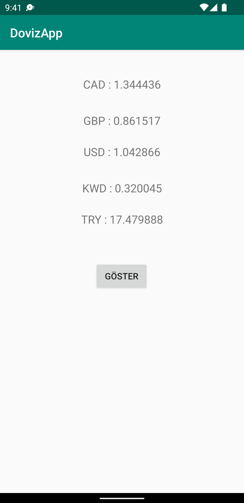
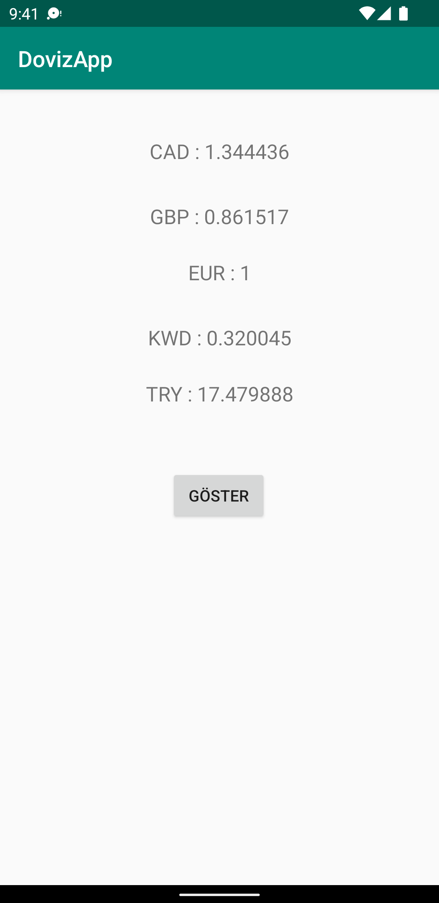

# DovizApp

[Türkçe](README.tr.md) · [Español](README.es.md)

DovizApp is an Android app that shows the latest foreign-exchange rates on a single screen. It does not convert an amount you type. When you tap **Kurları göster**, it downloads the current rates and fills the list. Refreshing the rates needs a network connection.

The figures come from the [Fixer](https://fixer.io/) latest-rates endpoint. That feed uses the euro as its base currency, so each value is the amount of that currency equal to **1 EUR**.

## Rates

| Code | Currency | What the row means |
| --- | --- | --- |
| CAD | Canadian dollar | Canadian dollars per 1 euro |
| GBP | British pound sterling | Pounds per 1 euro |
| EUR | Euro | Base currency; the value is 1 |
| KWD | Kuwaiti dinar | Dinars per 1 euro |
| TRY | Turkish lira | Lira per 1 euro |

Until the first successful refresh, the rows show the currency code only. Afterward they look like `TRY : 17.479888`, the sample stored in the second screenshot.

## Screenshots

Both images are already in the repository:

 

`screen_1.png` is the screen before a refresh. `screen_2.png` is the same screen after the rates load, including `EUR : 1`. Those captures still show the older button label **GÖSTER**, and the first image still has a **USD** placeholder on the third row. The current screen labels that row **EUR** and the button **Kurları göster**.

## Build requirements

Build with the toolchain already on `master`:

- Android Gradle Plugin **9.4.1**
- Gradle **9.8.1**, pinned by the wrapper
- `compileSdk` **37** and `targetSdk` **37**
- `minSdk` **24**
- JDK **17** or newer (verified with JDK 21)
- Android Studio Rabbit 1 (2026.2.1) or newer
- Android SDK Platform 37 and Android SDK Build-Tools 36.0.0 or newer

## Build

From the project root, the wrapper selects Gradle 9.8.1:

```bash
./gradlew assembleDebug
```

The debug APK is written to `app/build/outputs/apk/debug/app-debug.apk`.

To install that build on a connected device or a running emulator (API 24 or higher):

```bash
./gradlew installDebug
```

On Windows, run `gradlew.bat` instead of `./gradlew`. You can also open the project in Android Studio and run the `app` configuration.

## Support

If this project is useful, you can buy the author a coffee:

[](https://www.buymeacoffee.com/halilozel1903)

## License

DovizApp is released under the MIT License. Copyright (c) 2022 Halil OZEL.

```
MIT License

Copyright (c) 2022 Halil OZEL

Permission is hereby granted, free of charge, to any person obtaining a copy
of this software and associated documentation files (the "Software"), to deal
in the Software without restriction, including without limitation the rights
to use, copy, modify, merge, publish, distribute, sublicense, and/or sell
copies of the Software, and to permit persons to whom the Software is
furnished to do so, subject to the following conditions:

The above copyright notice and this permission notice shall be included in all
copies or substantial portions of the Software.

THE SOFTWARE IS PROVIDED "AS IS", WITHOUT WARRANTY OF ANY KIND, EXPRESS OR
IMPLIED, INCLUDING BUT NOT LIMITED TO THE WARRANTIES OF MERCHANTABILITY,
FITNESS FOR A PARTICULAR PURPOSE AND NONINFRINGEMENT. IN NO EVENT SHALL THE
AUTHORS OR COPYRIGHT HOLDERS BE LIABLE FOR ANY CLAIM, DAMAGES OR OTHER
LIABILITY, WHETHER IN AN ACTION OF CONTRACT, TORT OR OTHERWISE, ARISING FROM,
OUT OF OR IN CONNECTION WITH THE SOFTWARE OR THE USE OR OTHER DEALINGS IN THE
SOFTWARE.
```
